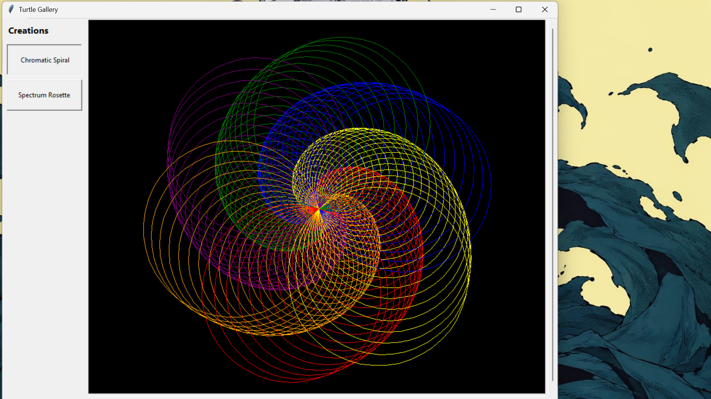

# Turtle Gallery


A small Python desktop app that shows a gallery of turtle graphics creations. Pick a tile on the left and its creation draws itself on the canvas.



## Features

- One tile per creation, each with its own drawing
- Drawings animate step by step, and you can switch tiles while one is still drawing
- Every drawing is scaled to fit the window, whatever its size
- Plain Tkinter and the standard `turtle` module, no extra packages

## Creations

| Tile | What it draws |
|---|---|
| Chromatic Spiral | 200 overlapping circles in six colours, each turned 59 degrees from the last |
| Spectrum Rosette | 36 circles that step through the colour wheel, each turned 10 degrees |
| Spectrum Tree | A recursive fractal tree whose branches shift through the colour wheel, from trunk to tips |

## Download

On Windows, download `turtle-gallery.exe` from the [latest release](https://github.com/Nathani21/turtle-gallery-gui/releases/latest) and double-click it. Windows SmartScreen may warn because the file isn't code-signed: click "More info", then "Run anyway".

## Run it from source

You need Python 3 with Tkinter (included in the Windows installer from python.org). Developed and tested on Python 3.13 on Windows.

```
git clone https://github.com/Nathani21/turtle-gallery-gui.git
cd turtle-gallery-gui
python turtle_gallery.py
```

Each creation also runs on its own, for example `python creations/chromatic_spiral.py`.

## How it works

- `creations/` holds one file per creation. Each file has three things: a `draw(t)` generator that yields after every step, an `EXTENT` (how far from the centre the drawing reaches), and a `STEP_MS` (the pause between steps).
- `creations/__init__.py` has the `CREATIONS` registry that maps each tile name to its creation.
- `turtle_gallery.py` builds one tile per registry entry, fits the canvas to the creation's `EXTENT`, and runs the generator one step at a time with Tkinter's `after()`.

## Adding a creation

1. Copy `creations/chromatic_spiral.py` to a new file and change the drawing, `EXTENT` and `STEP_MS`.
2. Import it in `creations/__init__.py` and add one line to `CREATIONS`.
3. Run the tests. They check every registered creation automatically: it must run to completion and stay within its `EXTENT`.

## Tests

```
pip install pytest
python -m pytest
```

The tests cover the registry, the rainbow palette, and a full run of every creation on a hidden window. The gallery window itself is not covered. GitHub Actions runs the tests on every pull request (Windows, Python 3.13).

## License

MIT, see [LICENSE](LICENSE).